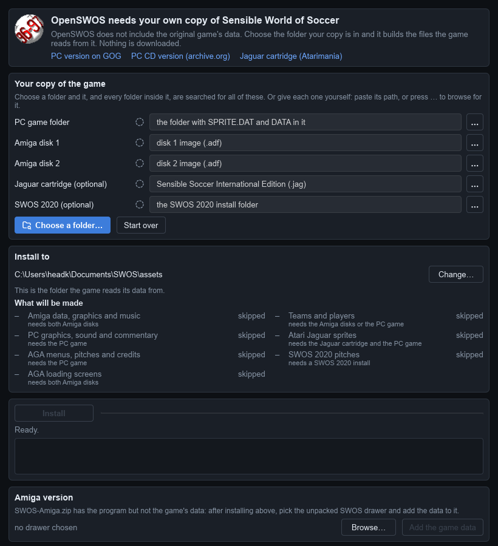
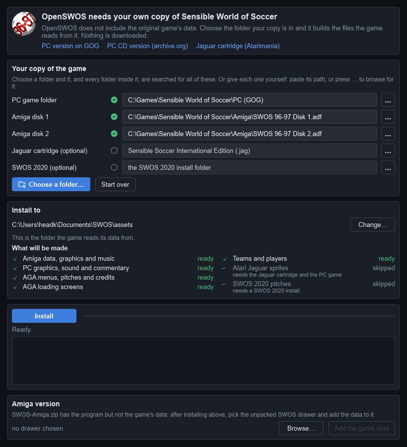
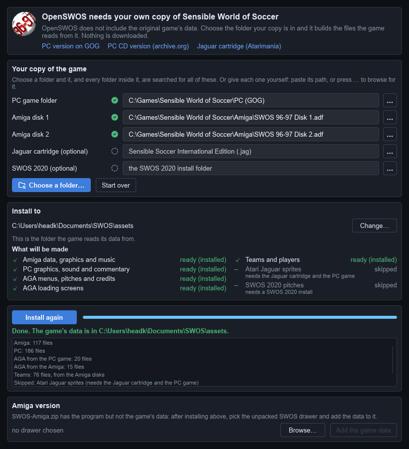

# Installing OpenSWOS

This guide takes you from nothing to playing, one step at a time. It takes about five
minutes.

**In short:** download OpenSWOS, then run **OpenSWOS Setup** once and show it where your
copy of *Sensible World of Soccer* is. That's it.

- [1. What you need](#1-what-you-need)
- [2. Download](#2-download)
- [3. Install the game](#3-install-the-game): [Windows](#windows) · [macOS](#macos) · [Linux](#linux) · [Amiga](#amiga)
- [4. Run OpenSWOS Setup](#4-run-openswos-setup)
- [5. Play](#5-play)
- [If something goes wrong](#if-something-goes-wrong)

---

## 1. What you need

**Your own copy of *Sensible World of Soccer 96/97*.** OpenSWOS is a new engine for the
game, but the game's graphics, music, sound and teams are still owned by their makers, so
they can't come with OpenSWOS. The setup makes them from your copy instead. Nothing is
downloaded.

Any **one** of these is enough to play:

| Your copy | Where to get it |
|---|---|
| **The PC version** (easiest) | Buy it on [GOG](https://www.gog.com/en/game/sensible_world_of_soccer_9697) and install it. The [PC CD version](https://archive.org/details/msdos_Sensible_World_of_Soccer_96-97_1996) works too. |
| **The Amiga version** | Disk images (`.adf` files) of your two SWOS 96/97 floppies. |

**Have both?** Use both: you get the Amiga's music, sound and loading screens as well as
the PC's commentary. The real Amiga version of OpenSWOS needs both.

Two extras are optional, for players who have them: the **Atari Jaguar** cartridge image
(for the Jaguar's sprites) and a **SWOS 2020** install (for its pitches).

---

## 2. Download

Get OpenSWOS from **<https://baker76.itch.io/openswos>**. That page and **openswos.net** are
the only official places to get it: OpenSWOS is free, and never asks you to pay or sign up
anywhere else. Pick the file for your computer:

| Your computer | Download |
|---|---|
| **Windows** | `SWOS-Setup.exe` — the installer |
| **Mac** (Apple silicon or Intel) | `SWOS-macOS-app.zip` |
| **Linux** (PC or Raspberry Pi) | `SWOS-portable.zip`, and `OpenSWOS-Setup.zip` for the setup window |
| **Amiga** (A1200/A4000 or an emulator) | `SWOS-Amiga.zip`, and `OpenSWOS-Setup.zip` to run on a PC or Mac |

---

## 3. Install the game

### Windows

1. Run **`SWOS-Setup.exe`**.
   - If Windows says *"Windows protected your PC"*, click **More info**, then **Run anyway**.
     OpenSWOS isn't signed by Microsoft, which is why it asks.
2. Click **Next** through the installer.
3. On the last page, leave **"Set up the game data from your copy of Sensible World of
   Soccer"** ticked and click **Finish**. OpenSWOS Setup opens: go to
   [step 4](#4-run-openswos-setup).

Later, you can open the setup again from the Start menu: **OpenSWOS → OpenSWOS Setup**.

### macOS

1. Double-click **`SWOS-macOS-app.zip`**. You get an **OpenSWOS** folder holding
   **SWOS.app** and **OpenSWOS Setup.app**.
2. Drag the **OpenSWOS** folder to **Applications** (or anywhere you like).
3. Open **OpenSWOS Setup.app**. **The first time, right-click it (or Control-click) and
   choose Open**, then **Open** again. OpenSWOS isn't signed by Apple, so a plain
   double-click is refused the first time. Then go to [step 4](#4-run-openswos-setup).

Do the same right-click → **Open** the first time you start **SWOS.app**.

### Linux

1. Unzip **`SWOS-portable.zip`** into a folder of its own, e.g. `~/Games/OpenSWOS`.
2. Unzip **`OpenSWOS-Setup.zip`** anywhere, and run **`Linux/openswos-setup`** from it.
   Go to [step 4](#4-run-openswos-setup).

Which game file to run: **`SWOS.x86_64`** on a normal 64-bit PC, **`SWOS.aarch64`** on a
64-bit Raspberry Pi (Pi 4/5), **`SWOS.armhf`** on a 32-bit Pi. You need a Linux from 2021
or newer (Ubuntu 21.10, Debian 12, Fedora 35 or later).

### Amiga

The setup can't run on the Amiga itself, so you do this part on a PC or a Mac:

1. Unzip **`SWOS-Amiga.zip`**. You get a **SWOS** drawer (and its icon, `SWOS.info`).
2. Unzip **`OpenSWOS-Setup.zip`** and run the setup for your computer:
   `Windows\openswos-setup.exe`, `macOS/OpenSWOS Setup.app` or `Linux/openswos-setup`.
3. Do [step 4](#4-run-openswos-setup) below. **You need both Amiga disk images** for the
   Amiga version.
4. Then, at the bottom of the setup window under **Amiga version**, click **Browse…**,
   pick the **SWOS** drawer from step 1, and click **Add the game data**.
5. Copy the **SWOS** drawer (with `SWOS.info`) to your Amiga's hard drive, or to the hard
   drive of FS-UAE / WinUAE. Open the drawer and double-click **SWOS**.

You need an AGA Amiga with a 68020 or better (an A1200 or A4000, or an emulator set up as
one), with a hard drive and Workbench.

---

## 4. Run OpenSWOS Setup

This is the one step that matters. When the setup opens, it looks like this:

**1. Click "Choose a folder…"** and pick a folder your game is in. The setup looks
through that folder **and every folder inside it**, so you don't have to be exact: choosing
the folder that holds your GOG game, your `.adf` files, or both, is enough.

Each part it finds gets a green tick. Here it found the PC version and both Amiga disks:

- Under **What will be made**, everything marked **ready** will be installed. Parts marked
  **skipped** need something you don't have; that's fine, the game plays without them.
- Something not found? Click the **…** button beside it and pick the file or folder
  yourself, or paste its path into the box.
- **Install to** is where the game reads its data from. Leave it as it is.

**2. Click Install.** It takes a few seconds. When it says **Done**, you're finished:

You only need to do this once: a new version of OpenSWOS uses the same data.

*(The screenshots are from Windows; the setup looks the same on a Mac and on Linux.)*

---

## 5. Play

- **Windows:** start **OpenSWOS** from the Start menu (or the desktop, if you ticked that
  in the installer).
- **Mac:** open **SWOS.app** (right-click → **Open** the first time).
- **Linux:** run `SWOS.x86_64` (or the one for your Pi) from the folder you unzipped.
- **Amiga:** double-click **SWOS** in its drawer.

Menus use the **arrow keys** and **Enter** (or a gamepad). In a match, the arrow keys
move and **Ctrl**, **Space** or **Enter** kick. All the keys and the gamepad buttons are in
[docs/PLAYING.md](docs/PLAYING.md).

**Playing online:** choose **MULTIPLAYER** on the main menu. Both players need the same
version of OpenSWOS.

---

## If something goes wrong

**The setup doesn't find my game.**
Click the **…** beside the missing part and pick it by hand:
- *PC game folder*: the folder with `SPRITE.DAT` and a `DATA` folder in it. GOG puts it
  where you chose when installing, usually under `C:\GOG Games` or under
  `GOG Galaxy\Games` in Program Files.
- *Amiga disk 1 / 2*: the `.adf` files themselves.

**The game won't start, or starts without graphics or sound.**
The game data usually isn't installed. Run OpenSWOS Setup again and check it says
**Done**. The game writes what happened to `SWOS.log`, in the folder below.

**Windows or the Mac won't let me open it.**
OpenSWOS isn't signed. On Windows click **More info → Run anyway**; on a Mac right-click
the app and choose **Open**.

**My gamepad doesn't work.**
See [docs/PLAYING.md](docs/PLAYING.md#gamepad-not-detected).

**Where are my saves and settings?**

| Computer | Folder |
|---|---|
| Windows | `Documents\SWOS` |
| Mac | `~/Library/Application Support/SWOS` (in Finder: **Go → Go to Folder…**) |
| Linux | `~/.swos` |
| Amiga | the `save` folder inside the SWOS drawer |

Saves are in `save`, the settings in `SWOS.ini` ([docs/SETTINGS.md](docs/SETTINGS.md)),
the game data from the setup in `assets`. Reinstalling or updating OpenSWOS never touches
them.

**Still stuck?** Ask on the [OpenSWOS page on itch.io](https://baker76.itch.io/openswos), and
include what your `SWOS.log` says.
