<p align="center">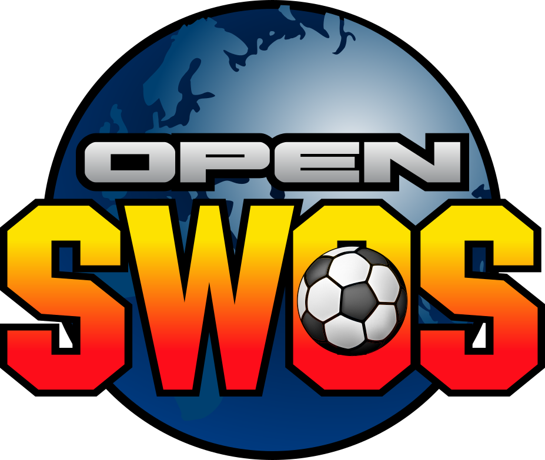</p>

# OpenSWOS — Pure C port, Amiga + SDL2 from one source tree

A pure C port of *Sensible World of Soccer* (Amiga, 1994). The original 68k
assembly has been translated to C, and **one source tree builds three targets**:

| Target | Build | Output |
|---|---|---|
| **SDL2** — Windows, Linux, WSL2, macOS, WebAssembly, ARM | `make` | `bin/SWOS*` |
| **Amiga m68k** — A1200/AGA, FS-UAE/WinUAE or real hardware | `make -f Makefile.amiga` | `bin/SWOS2` |
| **Nintendo Switch** — devkit only; needs the licensee SDK + SDL fork | `scripts/build_switch.sh` | `bin/SWOS.nss` |

On SDL the OCS/AGA chipset, Paula audio, and joystick I/O are emulated by thin
SDL2 shims; on Amiga the same C drives the real hardware. `src/` and `include/`
are shared — platform divergence is expressed with `#ifdef SWOS_SDL_BUILD`, and
a short list of SDL-only files is excluded from the m68k build by name
(`SDL_ONLY_SRCS` in `Makefile.amiga`).

The C didn't come from nowhere: it's the downstream product of
**[SWOS-RE](https://github.com/benbaker76/SWOS-RE)**, a separate reverse-engineering
project that documents the original Amiga 68k binary — IDA Pro + Ghidra databases,
function/variable/struct naming, sprite and menu formats, and the annotated
`SWOS2.s` disassembly this port was first translated from. If you want to know
*why* a piece of this code looks the way it does, that's where the answer lives.

> These were two separate repos (`SWOS_C_SDL` and `SWOS_C`) kept in step by a
> one-way copy script until they were merged on 2026-08-12. Older notes in
> `docs/` that talk about "back-porting" or `sync_to_amiga_port.sh` describe
> that historical workflow — there is no sync step any more.

## Screenshots

| | |
|---|---|
| 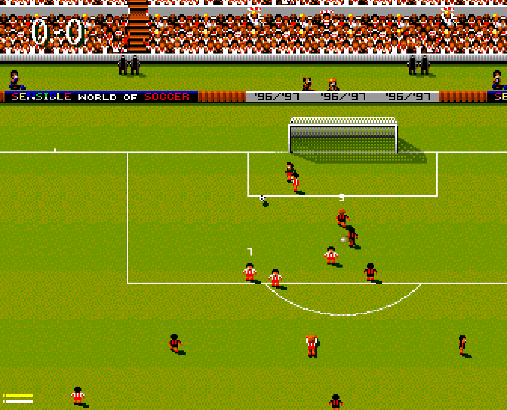 | 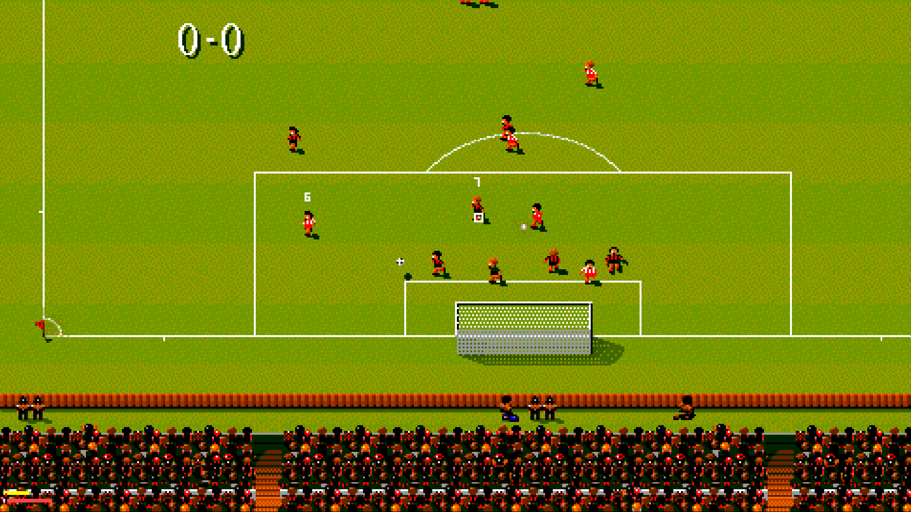 |
| A match from the stand | Widescreen (16:9) |
| 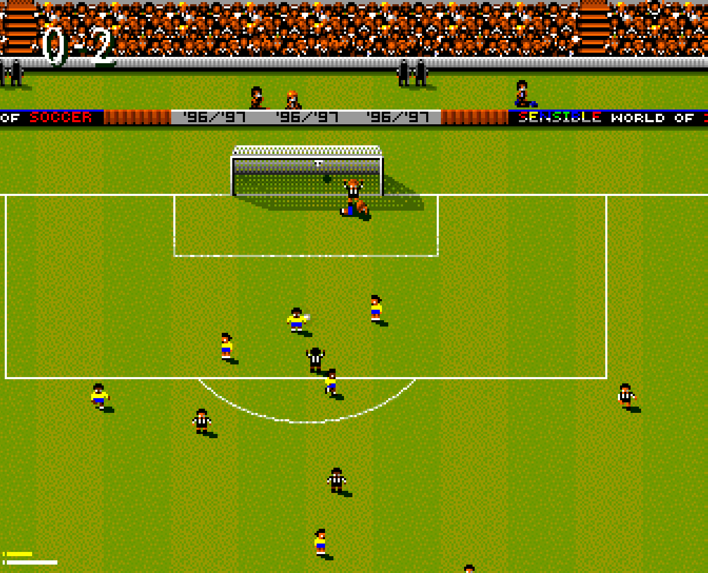 | 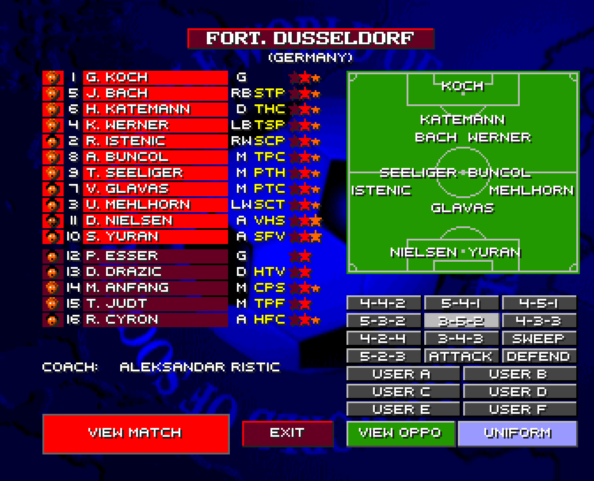 |
| In play | Team line-up |
| 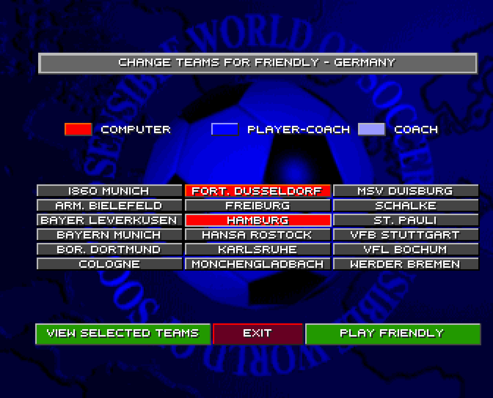 | 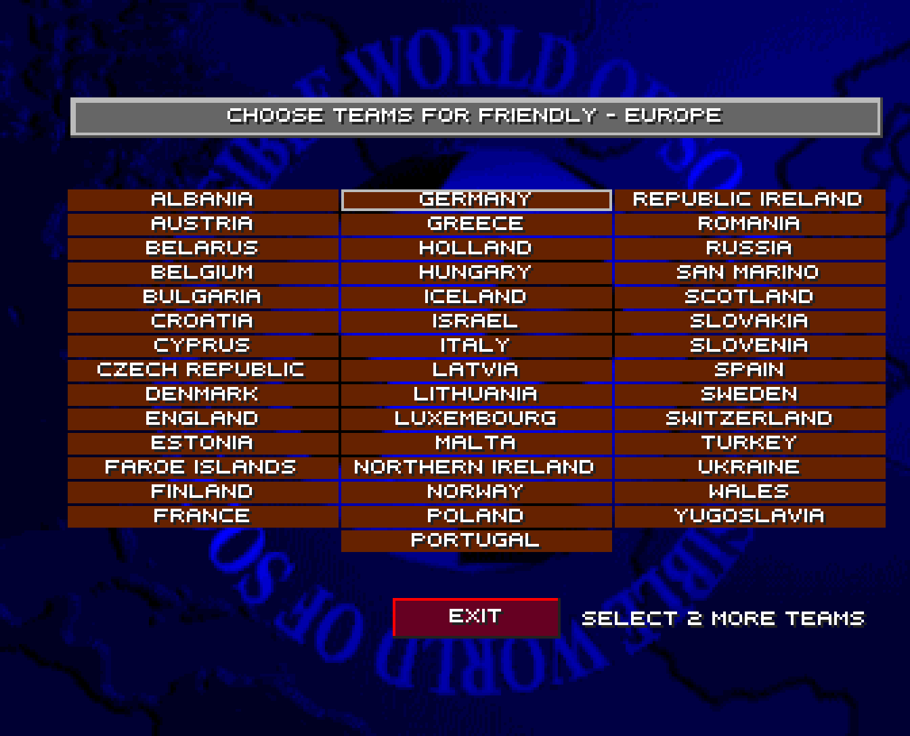 |
| Choosing teams | Picking a country |
| 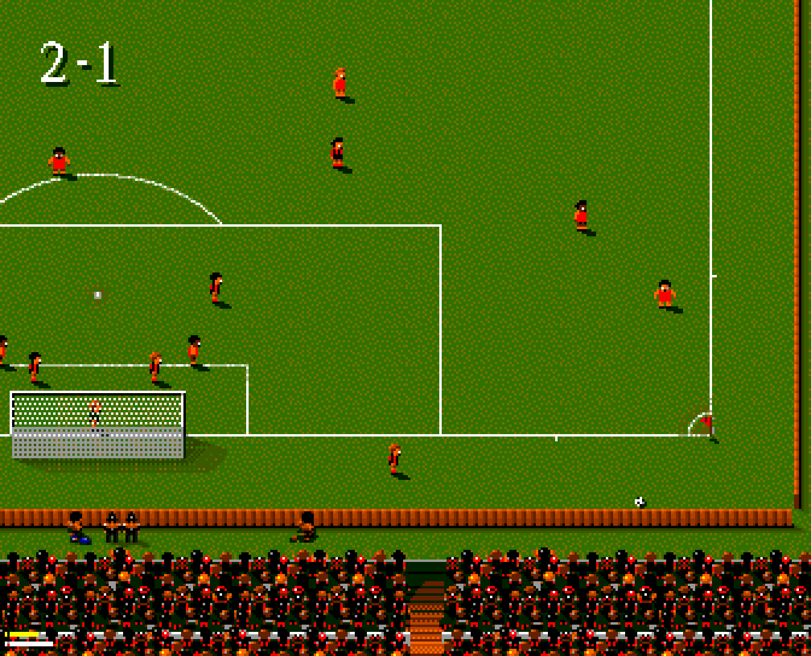 | 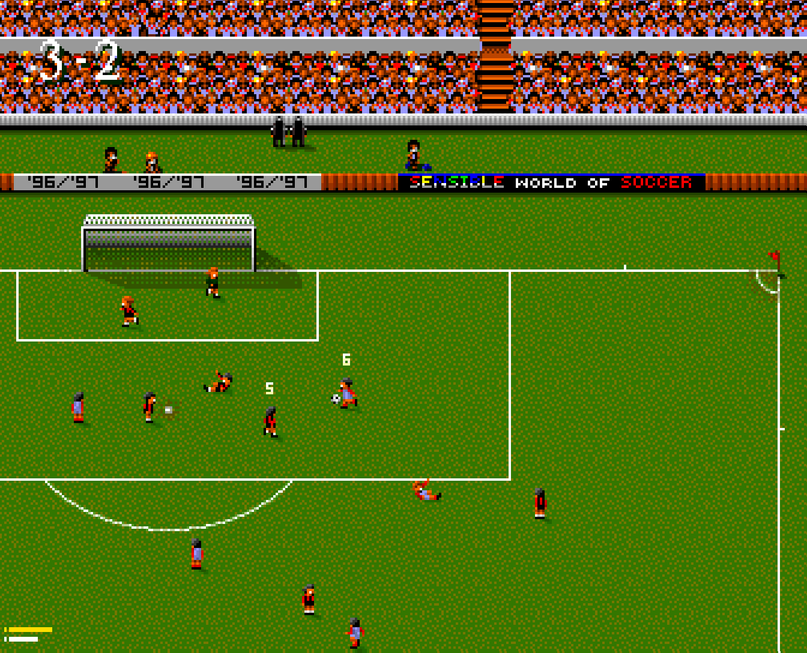 |
| PC (DOS) graphics | Atari Jaguar sprites |
| 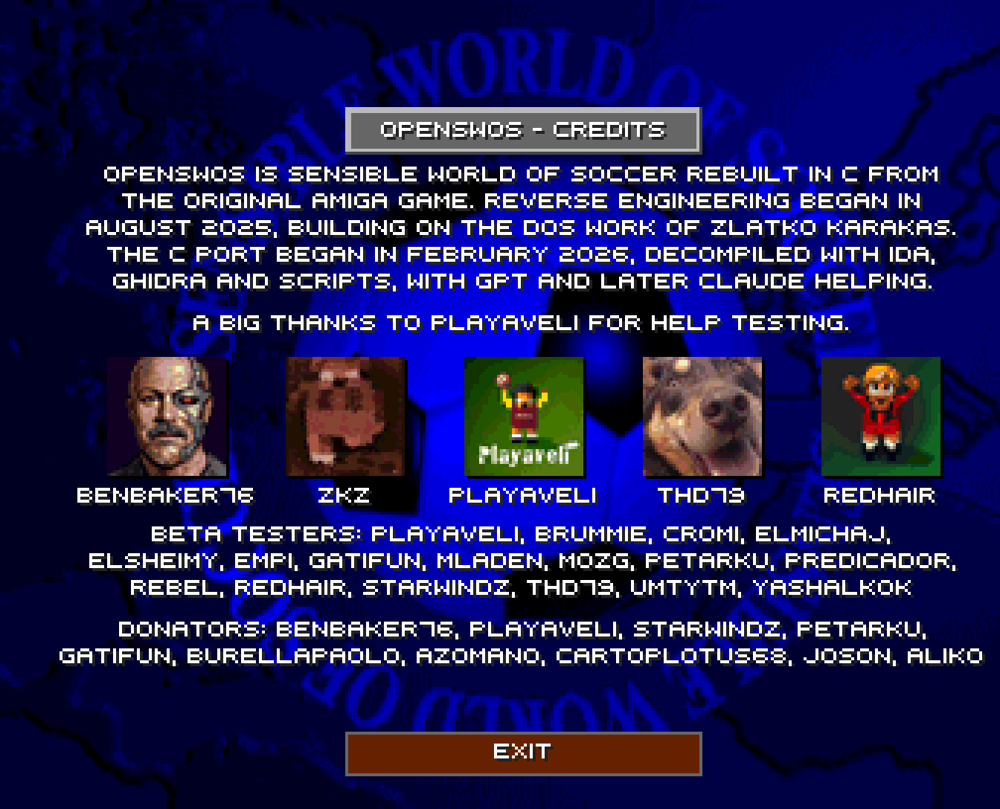 | 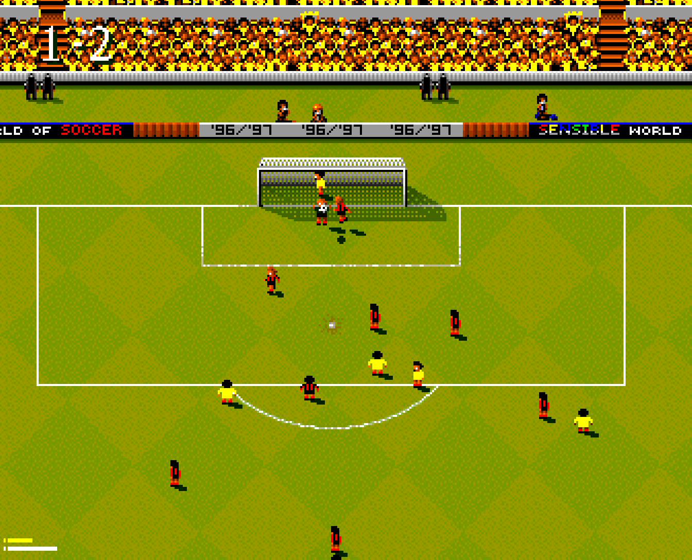 |
| The credits | The Amiga pitch |
| 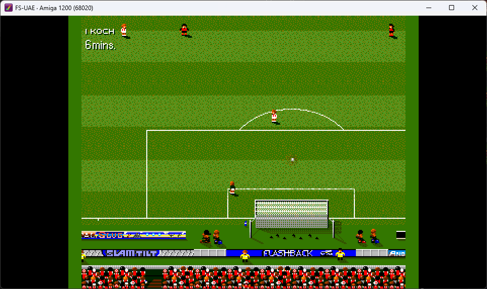 | 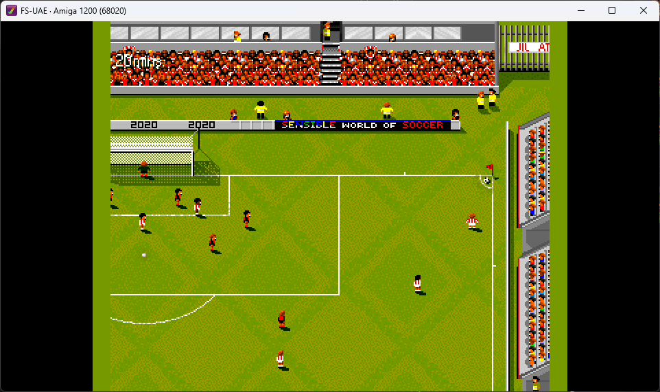 |
| The Amiga 1200 (AGA) build in FS-UAE | The Amiga 1200 (AGA) build in FS-UAE |

## Goals

1. **Keep both targets building.** A change to shared code has to compile for
   m68k as well as SDL. The Amiga build is the stricter of the two (32-bit
   pointers, big-endian, `-nostdlib`), so it catches bitness and endian slips
   the SDL build would let through.
2. **Retire `SWOS2.s`.** It is now reference material (`data/SWOS2.s`) — the
   Amiga build already runs entirely from C.
3. **Untangle the Amiga BSS overlays.** The current code mirrors the Amiga's
   memory layout faithfully (adjacent-globals, `careerFileBuffer` overlays,
   `selTeamsPtr` aliased onto its own data). Once both ports run on C, those
   overlays become proper structs with named fields.
4. **Replace the save format.** The current `.CAR` format is a raw memory
   dump of the career-buffer overlay region — fragile and contains absolute
   pointers. Eventually replace with a structured format (JSON or tagged
   binary) that serialises named fields, not memory addresses.

## Status

Working:

- Full front-end navigation: NEW CAREER, CHOOSE TEAM, chairman memo flow,
  view competitions, management record, scorers, transfer market.
- Save / load `.CAR` career files (round-trips clean — magic-checked, layout
  preserved via shared backing buffer + `.equ` aliases).
- Friendly matches, career matches: pitch renders + scrolls, players animate,
  ball physics, AI, set-pieces.
- Crowd chants, in-match SFX (whistle, kicks, throw-ins).
- Substitutions (triple-tap, or the L / R shoulder buttons), tactics editing.
- 1-player keyboard, 1-player gamepad, 2-player gamepad; the spare pad
  buttons drive pause, statistics, the replays, the substitution menus and
  quit — see [Controls](#controls).
- **Nintendo Switch**: builds, packages, installs and runs on a devkit. See
  [docs/SWITCH.md](docs/SWITCH.md).
- Arcade (coin-op) mode with attract loop and operator service menu — see
  [Arcade mode](#arcade-mode).
- Runs in the browser via WebAssembly (`make WASM=1`), saves persisted to
  IndexedDB.

Known issues (open):

- Player sprites: occasional palette / shape glitches.
- Ball sprite: sometimes invisible at edge of camera.
- Brief flicker (1–2 frames) on some menu transitions (e.g., post-match
  RESULT, lineup-swap).
- Amiga-side: builds and links from the shared tree, but the AGA render path
  (mixed-depth sprites, FMODE scroll) is still work-in-progress — see docs/AGA.md.

This is a personal project under active development; expect rough edges.

## You need the original Amiga data files

This repo contains the engine, **not the game data.** SWOS is still under
copyright and the data files (graphics, sound modules, team files,
fixtures) are not redistributed.

You need a legitimate copy of *Sensible World of Soccer* for Amiga (e.g., the
ADF/HDF you dumped from your own floppy or hard-disk install). Place the
following directories from the Amiga distribution into `bin/`:

```
bin/
├── data/       (TEAM.000…TEAM.0FE, POOLPLYR.DAT, EUROCUP.TMD, …)
├── grafs/      (4-bitplane OCS sprites)
├── grafs_aga/  (8-bitplane AGA sprites)
└── sound/      (HERO.SNG, MENU.SNG, SFX.SNG/IN1/IN2, …)
```

**Where saves go differs by target**, because the two have different
constraints:

- **SDL** writes saves to the per-user folder described under
  [Settings file](#settings-file-swosini) — e.g.
  `%USERPROFILE%\Documents\SWOS\save\` — so an installed copy in a
  read-only directory still works.
- **Amiga** writes to `bin/save/`, since FS-UAE mounts `bin/` as DH1: and the
  game's paths are relative to it.

Both are created automatically. The JSON save format is designed to move
between the two — it serialises *named fields* and semantic identities rather
than raw memory and pointers, so a save survives 32↔64-bit and LE↔BE. Copying
a `.CAR`/`.SEA`/`.PRE`/`.DIY`/`.HIL` across has been verified for league
careers; cup and tournament careers aren't fully cross-target tested yet.
See `docs/SAVE_FORMAT_JSON.md`.

## Building

The Makefile auto-detects the host and produces a binary named per the
target architecture. Pass an arch flag for cross builds.

| Target                                 | Command                | Output                |
|----------------------------------------|------------------------|-----------------------|
| Linux x86 (default, 32-bit)            | `make`                 | `bin/SWOS`            |
| Linux x86_64 (64-bit)                  | `make X86_64=1`        | `bin/SWOS.x86_64`     |
| Linux ARM64 (aarch64) — Pi 4/5 etc.    | `make ARM64=1`         | `bin/SWOS.aarch64`    |
| Linux ARM32 (armhf, armv7-a + NEON)    | `make ARM=1`           | `bin/SWOS.armhf`      |
| Windows                                | `make` on MSYS2/Cygwin | `bin/SWOS.exe`        |
| macOS (native, single-arch)            | `make`                 | `bin/SWOS.macos`      |
| macOS universal binary (x86_64 + arm64)| `make macos-universal` | `bin/SWOS.macos`      |
| macOS `.app` bundle (data + SDL2 inside)| `make macos-app`       | `bin/SWOS.app`        |
| WebAssembly (browser)                  | `make WASM=1`          | `dist/web/SWOS.html`  |
| **Amiga m68k (A1200/AGA)**             | `make -f Makefile.amiga` | `bin/SWOS2`         |

Common flags:
- `make clean` first if you've switched between archs in the same checkout.
- `make SWOS_DEBUG=1` adds the diagnostic-logging build (autoskip / sfx).
- `make -j4` (or higher) parallelises the compile.

### Linux x86 (32-bit, default)

Default target. Compiles with `-m32` so the Amiga `long`/pointer struct
sizes match the original 68k layout on a 64-bit host. Needs the 32-bit
SDL2 + multilib gcc:

```
# Debian / Ubuntu
sudo apt install gcc-multilib libsdl2-2.0-0:i386 libsdl2-dev:i386

# Arch
sudo pacman -S lib32-sdl2
```

```
make
./bin/SWOS
```

### Linux x86_64 (64-bit)

Same code path, no `-m32`. The 64-bit struct sizes are picked up via
the bitness-conditional `size_check[]` asserts (same as macOS / aarch64).
Needs the 64-bit SDL2 (`libsdl2-dev` on Debian / Ubuntu, not the
`:i386` cross-arch one).

```
sudo apt install libsdl2-dev
make X86_64=1
./bin/SWOS.x86_64
```

### Linux ARM64 (Raspberry Pi 4 / 5, aarch64 server, etc.)

```
# Native on the Pi (Raspberry Pi OS 64-bit)
sudo apt install build-essential libsdl2-dev
make ARM64=1
./bin/SWOS.aarch64
```

Cross-building from an x86_64 host is a bit more involved — enable the
foreign architecture and install both the cross-compiler and arm64 SDL2:

```
sudo dpkg --add-architecture arm64
sudo apt update
sudo apt install gcc-aarch64-linux-gnu libsdl2-dev:arm64

make ARM64=1
```

The Makefile picks `aarch64-linux-gnu-gcc` and reads SDL2 from the
matching pkgconfig directory. ARM64 is LP64 — no `-m32`.

### Linux ARM32 (armhf, Raspberry Pi 2 / 3, or Pi 4/5 in 32-bit mode)

Native on the Pi:

```
sudo apt install build-essential libsdl2-dev
make ARM=1
./bin/SWOS.armhf
```

Cross-build from an x86_64 Debian/Ubuntu host needs the armhf foreign
arch enabled. Ubuntu's default sources don't carry armhf packages, so
you also have to point apt at `ports.ubuntu.com` (Debian users: skip,
`deb.debian.org` has all archs):

```
sudo dpkg --add-architecture armhf

# Restrict your existing amd64 sources so apt doesn't try ports for them.
sudo sed -i -E 's,^(deb )(http),\1[arch=amd64] \2,' /etc/apt/sources.list

# Add armhf sources. You need ALL FOUR pockets — main universe +
# -updates + -security + -backports — otherwise libsdl2-dev:armhf
# pulls in an old libc6:armhf and refuses to install. Replace 'jammy'
# with your Ubuntu codename (`lsb_release -cs`; jammy = 22.04, noble = 24.04).
CODENAME=$(lsb_release -cs)
sudo tee /etc/apt/sources.list.d/ports-armhf.list <<EOF
deb [arch=armhf] http://ports.ubuntu.com/ubuntu-ports/ $CODENAME main universe
deb [arch=armhf] http://ports.ubuntu.com/ubuntu-ports/ $CODENAME-updates main universe
deb [arch=armhf] http://ports.ubuntu.com/ubuntu-ports/ $CODENAME-security main universe
deb [arch=armhf] http://ports.ubuntu.com/ubuntu-ports/ $CODENAME-backports main universe
EOF

sudo apt update
sudo apt install gcc-arm-linux-gnueabihf libsdl2-dev:armhf

make ARM=1
```

Compiles for `armv7-a` with NEON (covers Pi 2 / 3 / 4 / 5 in 32-bit
mode). armhf is already ILP32 so no `-m32`. Override the toolchain
prefix with `make ARM=1 CC=...` if your distro uses a different one.

### Windows

Build with MSYS2 / MinGW32 (gcc 32-bit), Cygwin 32-bit, or cross-compile
from Linux with `i686-w64-mingw32-gcc`. The Makefile auto-detects the
toolchain and emits `bin/SWOS.exe`.

For end users we ship the SDL2 DLL alongside the executable so no
external SDL2 install is needed — just unzip and run `SWOS.exe`.

### WSL2

The default `make` builds a Linux x86 binary that runs under WSL2 with
WSLg (or an X server). Audio uses queue mode (not callback) because
WSL2 + PulseAudio has uneven scheduling on the SDL audio callback
thread; the queue path is paced from the main game loop and is stable.

### macOS

Builds a Mach-O binary using clang / `cc`. Supports both Intel
(`x86_64`) and Apple Silicon (`arm64`) natively, and can produce a
universal binary that runs on both. Default deployment target is
macOS 11 (Big Sur).

```
# Single-arch native build
brew install sdl2 pkg-config
make
./bin/SWOS.macos

# Universal binary (x86_64 + arm64)
# Requires SDL2.framework from libsdl.org (universal, drop into /Library/Frameworks/)
make macos-universal
```

Full details — SDL2 framework setup, deployment-target overrides,
.app bundle layout, troubleshooting — are in
[`docs/MACOS_BUILD.md`](docs/MACOS_BUILD.md).

### Amiga (m68k)

The Amiga target uses a different Makefile and a different toolchain, but the
same `src/` and `include/`:

```
make -f Makefile.amiga -j$(nproc)
```

The m68k cross-toolchain (`m68k-amiga-elf-gcc`, `vasmm68k_mot`, `elf2hunk`)
ships inside the **Amiga C/C++ Compile, Debug & Profile** VS Code extension
rather than being installed system-wide, so put it on `PATH` first.

> ⚠️ **Use the [`benbaker76/vscode-amiga-debug`](https://github.com/benbaker76/vscode-amiga-debug)
> fork, not the marketplace build** of Bartman^Abyss's extension. The fork's
> FS-UAE carries the gdb **write**-packet support (`M`/`P`/`G`) that lets the
> AmigaScope harness *drive* the Amiga — inject input, set variables, call
> functions — rather than only read it, plus a log-spam fix. Both install to the
> same `bartmanabyss.amiga-debug-<ver>` directory and report the same publisher
> and upstream repo in `package.json`, so **you cannot tell them apart after the
> fact**. Symptom of being on the stock build: gdb reads memory fine, but writes
> and input injection silently do nothing.

Linux/WSL and macOS builds of the toolchain are both bundled. When building from
WSL, note the extension lives in the **Windows-side** `.vscode` — there is no
extension directory in the WSL home, and `~/.vscode` fails as `Error 127`
(which an already-up-to-date tree hides behind `Nothing to be done for 'all'`):

```
EXT=/mnt/c/Users/<your-user>/.vscode/extensions/bartmanabyss.amiga-debug-1.8.2/bin/linux
PATH="$EXT/opt/bin:$EXT:$PATH" make -f Makefile.amiga -j$(nproc)
```

From VS Code, use the **Build (Amiga)** task, then one of the *FS-UAE* /
*WinUAE* launch configurations.

Output is `bin/SWOS2` (an Amiga hunk executable) plus `bin/SWOS2.elf` and
`bin/SWOS2.map`. It links into `bin/` deliberately: the debugger mounts the
binary's directory as **DH1:** and `cd`s into it, so the game finds `data/`,
`grafs/`, `grafs_aga/`, `sound/` and `save/` there — the very same files the
SDL build reads. There is no separate Amiga copy of the game data.

Useful knobs:
- `make -f Makefile.amiga DBG=1` — `-O0` for reliable gdb line breakpoints
  (same struct/ABI layout, so save-format tests stay valid).
- `make -f Makefile.amiga EXTRA_CFLAGS=-DPITCH_SCROLL_TEST` — boots the
  standalone AGA pitch-scroll rig instead of the menu (see `docs/AGA_TEST.md`).
- Always check `bin/SWOS2.map` after a build that moves globals around —
  CHIP RAM placement is load-bearing and silently correct-looking on SDL.

**Adding a source file:** shared code just goes in `src/` and both targets
compile it. A file that needs SDL2 or hosted libc must also be listed in
`SDL_ONLY_SRCS` in `Makefile.amiga`, or the m68k build will try to compile it.

### Nintendo Switch

**For registered Nintendo developers only.** The NintendoSDK and the Switch
fork of SDL are both under NDA; neither is in this repository and neither may
be committed to it. Nothing here reproduces SDK source.

```bat
scripts\build_switch.bat            :: -> bin\SWOS.nss
scripts\build_switch.bat package    :: -> dist\SWOS.nsp, installable on a devkit
```

```bash
scripts/build_switch.sh [package|clean]   # the same, driven from WSL
```

The compile must run on the Windows side — NintendoClang is a Windows
executable — so the shell script wraps the batch file through Windows interop,
the same way the Cygwin target is reached. Point it at the two trees:

```
NINTENDO_SDK_ROOT   the NintendoSDK        (built against 22.2.10)
SDL_SWITCH_ROOT     libsdl-org/SDL-switch  (licensee-only)
```

The Switch is a flavour of the SDL build, so the same `src/` compiles — SWOS
renders 8bpp chunky into its own frontbuffer and only meets SDL at the texture
upload. What differs is filesystem and logging: content is a read-only `rom:/`
mount, saves are a per-account `save:/` mount that needs an explicit commit,
and `printf` reaches nobody so output goes to the target log. All of it, plus
the packaging and the things that cost an afternoon each, is in
**[docs/SWITCH.md](docs/SWITCH.md)**.

## Running

Launch the binary from anywhere — the program automatically `chdir()`s to
its own directory so `data/`, `grafs/`, `sound/`, and `save/` resolve
correctly. `stderr` is auto-redirected to `SWOS.log` next to the binary
(set `SWOS_NO_LOG=1` in the environment to disable).

### Settings file (`SWOS.ini`)

#### Where it lives

`SWOS.ini` is **not** kept next to the binary — it goes in a per-user
game folder, alongside your `save/` directory and `SWOS.log`. Install
directories are frequently read-only (Program Files, `/Applications`,
a Gatekeeper-quarantined bundle), so config and saves live where the
user can always write:

| Platform | Folder |
|----------|--------|
| Windows (incl. Cygwin) | `%USERPROFILE%\Documents\SWOS\` |
| macOS                  | `~/Library/Application Support/SWOS/` |
| Linux / other Unix     | `~/.swos/` |
| WebAssembly            | `/SWOS.ini` in the IndexedDB-backed mount (mirrored to `localStorage`) |

So on Windows the full path is
`C:\Users\<you>\Documents\SWOS\SWOS.ini`, with saves in
`…\Documents\SWOS\save\`. The folder is created at startup. If it
can't be determined or created (no `%USERPROFILE%` / `$HOME`), the game
falls back to the current directory, which is how a dev run from `bin/`
ends up with a local `./SWOS.ini`.

#### How it's applied

Resolution order at launch is: **defaults → SWOS.ini → command-line
flags** — a flag always wins over the file, but a value you only set in
the file (or via runtime keys like `+`/`-`, Alt+Enter, or the arcade F2
service menu) is remembered.

The file is created complete, with comments, if it doesn't exist. On
exit, any keys a newer build added are **appended** — your hand-edited
values and comments are never rewritten or reordered.

#### Full key reference

```ini
[video]
renderer=accel        ; software | accel (hardware-accelerated)
vsync=off             ; on | off — accel renderer only
subpixel_scroll=on    ; on | off — smooth sub-pixel scrolling (see below)
scaling=smooth        ; sharp | smooth — how the frame is scaled (see below)
crt_mask=off          ; off | aperture | slot | scanlines — synthetic CRT
                      ; shadow mask over the finished frame (see below)
crt_mask_strength=45  ; 0-100 — how dark the grille's off-phase gets
crt_vignette=0        ; 0-100 — darkens towards the corners, 0 = off
crt_corners=0         ; 0-100 — rounded-glass corner size, 0 = square
render_driver=auto    ; auto | opengl | direct3d11 | direct3d | software-backend
                      ; auto = SDL default (D3D11 on Windows). Use opengl if
                      ; replays/attract run in slow motion on Windows.
fullscreen=off        ; off | desktop | exclusive
scale=3               ; 1..4 window scale (windowed only)
resolution=auto       ; WxH (e.g. 2560x1080) drives the render aspect, or
                      ; auto for the desktop. Need not match the monitor.
screen=0              ; monitor index to open on, 0 = primary. Auto-clamped.

[audio]
mode=mono             ; mono | stereo

[general]
language=en           ; en | de | fr | es | it | nl
currency=pound        ; pound | dollar | euro

[dos]                 ; PC-only extras (Amiga is the definitive version)
directory=grafs_dos   ; folder under bin/ to load the DOS assets from
graphics=false        ; true | false — render the DOS-version graphics
gameplay=false        ; true | false — DOS 70 FPS physics/timer tuning

[arcade]              ; coin-op mode (PC-only). See docs/ARCADE.md
enabled=false         ; true | false — boot straight to attract mode, no menu
mode=GOLDEN GOAL      ; arcade game mode (F2 service menu)
game_seconds=45       ; 10..600
golden_goal=true      ; true | false
penalties_on_draw=true
goal_replay=true      ; replay each goal (the engine's AUTO REPLAYS)
attract_audio=music+sfx  ; music (HERO only) | sfx (reel crowd only) | music+sfx
gameplay=amiga        ; amiga (50fps feel) | dos (70fps); also picks the
                      ; attract_mode/<mode> reels
key_p1_credit=5       ; cabinet key bindings, SDL key names. MAME layout:
key_p1_start=1        ; 5/6 = coin P1/P2, 1/2 = start, F2 = service
key_p2_credit=6
key_p2_start=2
key_service=F2
```

Everything in `[arcade]` except `enabled` is also editable in-game from
the F2 service menu, which writes changes straight back to `SWOS.ini`.

### Command-line options

```
-f, --fullscreen          Shorthand for --fullscreen=desktop. Off by
                          default. Toggle at runtime with Alt+Enter.
--fullscreen=<desktop|exclusive|off>
                          Fullscreen mode at startup. Off by default.
                          'desktop' = borderless letterbox over the
                          current desktop, no resolution change. Fast
                          to toggle; on Windows XP the taskbar can
                          occasionally show through this borderless
                          window.
                          'exclusive' = true fullscreen with a display-
                          mode change. Always covers the taskbar (the
                          XP fix). Slower toggle, may flicker on
                          multi-monitor rigs.
--scale=<1|2|3|4>         Windowed pixel scale at startup. Default: 3.
                          Adjust at runtime with the + and - keys.
--renderer=<software|accel>
                          Choose the SDL renderer. Default: accel.
                          'accel' uses the platform's hardware backend
                          (D3D / OpenGL / Metal). 'software' is a CPU-only
                          fallback for hosts where the hardware path
                          misbehaves.
--subpixel=<on|off>       Smooth sub-pixel scrolling. Default: on.
                          The game draws at whole-pixel camera positions, so a
                          true scroll of 1.5 px/frame steps 1,2,1,2. This shifts
                          the presented frame by the fractional remainder.
                          Quantised to whole output pixels, so it never blurs;
                          inactive at 1x window scale, where there is no
                          sub-pixel resolution to use. Turn off to compare.
--scaling=<sharp|smooth>  How the frame is scaled to the window. Default:
                          smooth. A fullscreen scale is rarely a whole number
                          (1080/272 = 3.97), so a plain nearest copy gives one
                          source pixel 4 output pixels and its neighbour 3 —
                          uneven text, clock digits and shirt numbers. 'smooth'
                          pre-multiplies the frame by a whole number first and
                          resamples only the leftover fraction; 'sharp' is the
                          old single nearest copy. Both are identical at a
                          whole-number scale, which is every windowed scale, and
                          'smooth' needs a hardware renderer.
--vsync=<on|off>          Sync frame presents to monitor vblank.
                          Default: off. Only meaningful with
                          --renderer=accel. Turn on if you see screen
                          tearing; the manual 50 Hz game-tick pace
                          runs as a backstop regardless.
--audio=<mono|stereo>     Audio output mode. Default: mono.
                          The Amiga's 4 audio channels are hard-panned
                          (1,2 → left, 0,3 → right) by Paula, which
                          sounds lopsided on most modern speakers /
                          single-speaker laptops. 'stereo' restores
                          the original Amiga panning if you'd rather
                          hear it that way (e.g. on headphones).
--dos-graphics=<on|off>   Render the DOS-version graphics (from bin/grafs_dos)
                          instead of the Amiga graphics. Default: off.
                          PC-only extra; the Amiga look is the default.
--dos-gameplay=<on|off>   DOS gameplay tuning — 70 FPS physics/timer rates
                          instead of the Amiga's 50. Default: off.
--dos-dir=<folder>        Folder under bin/ to load the DOS assets from.
                          Default: grafs_dos.
-h, --help                Show usage and exit.
```

There is deliberately **no `--arcade` flag** — arcade mode is enabled only via
`[arcade] enabled=true` in `SWOS.ini`, so a cabinet can't be knocked out of
coin-op by a stray command line. Every other `[arcade]` key is adjustable
in-game from the F2 service menu.

#### Choosing a render mode

SWOS' game logic runs at a fixed 50 Hz (the original PAL VBlank rate).
How smooth that looks on a given monitor depends on whether each frame
present aligns with the display's refresh:

| Monitor refresh | Suggested flags                              | Result                                                                                       |
|-----------------|----------------------------------------------|----------------------------------------------------------------------------------------------|
| 50 Hz           | `--vsync=on`                                 | Perfect 1:1 pacing. Each game frame lands on a vblank.                                       |
| 60 Hz / 75 Hz   | default (`--vsync=off`) or `--vsync=on` if you see tearing | Manual 50 Hz pace gates the game; the 50 → 60 pulldown is inherent.              |
| 144 Hz / 240 Hz | default                                      | Same as above; the manual pace fills the slack between vblanks.                              |
| Buggy hardware backend | `--renderer=software`                  | Drops to the CPU path. No monitor sync, manual pace only.                                    |
| Any refresh that is an exact multiple of 50 (100 / 150 / 200 / 300 Hz) | `--vsync=on` | Every game frame gets a whole number of refreshes — pacing is exact. `SWOS.log` says which case you are in. |

**If motion still is not perfectly fluid, it is probably not pacing.** The game
advances the camera at a fixed 50 Hz and draws at whole-pixel positions, so a
long ball moves the view up to 5 px in one 20 ms step and a fractional velocity
renders as an alternating 1,2,1,2 px cadence. `subpixel_scroll` (above) smooths
the second of those; the first needs the render/logic decoupling designed in
`docs/AMIGA_60.md`. `SWOS.log` reports the detected refresh rate, whether vsync
actually engaged (a driver or control panel can silently drop it), and whether
the refresh is an exact multiple of the game's pace.

### CRT effects

A modern panel draws SWOS's 336x272 as huge, razor-sharp squares. The `crt_*`
settings put back what an arcade tube did to the picture:

| setting | effect |
|---|---|
| `crt_mask=aperture` | vertical RGB phosphor grille (Trinitron-ish) |
| `crt_mask=slot` | aperture plus row-staggered slots — a shadow mask |
| `crt_mask=scanlines` | horizontal scanlines only |
| `crt_vignette` | darkens towards the corners |
| `crt_corners` | rounded glass edge |

All default off. The mask, vignette and corners fold into **one** pre-built
texture that is multiplied over the finished frame, so the cost is a single
full-screen draw no matter how many are enabled — the approach CannonBall-SE
uses to hold 60 fps on a Pi2 without a shader. Because it is a multiply, black
stays black and the grille shows in the mid-tones, which is what reads as "CRT"
rather than merely "dark". The texture is built at output resolution so the
grille lands on whole screen pixels.

This is presentation only: it runs on the finished frame and cannot affect the
simulation, so it is safe to leave on for replays and recordings.

**Uneven pixels are a different problem from uneven pacing.** The game renders
272 rows, and a monitor is almost never a whole multiple of that — 1080/272 =
3.97 — so scaling the frame with a plain nearest copy hands one source pixel 4
output pixels and its neighbour 3. Nothing moves, but text, clock digits and
shirt numbers look subtly wrong. `scaling=smooth` (the default) fixes it without
black bars or cropped rows: the frame is first blown up by a *whole* number with
nearest — exact NxN blocks, no error — and only the leftover fraction (3.97/4 =
0.99) is resampled. Both passes run on the GPU off the same single upload, so
the cost is one extra blit; measured at 3440x1440 it is 0.33 ms of a 20 ms
frame, and it drops the edge-placement error from 0.42 to 0.10 output pixels.
`SWOS.log` reports the factor it chose. `--scaling=sharp` restores the old
single copy to compare.

## Controls

### Menus

| Action       | Keyboard           | Gamepad (any pad)    |
|--------------|--------------------|----------------------|
| Navigate     | Arrow keys         | D-pad / left stick   |
| Select       | Right Ctrl / Space / Left Ctrl / Enter | A or B button |
| Quit         | Esc (only at the top-level main menu) or window close (✕) | — |

### In-match (Player 1)

| Action       | Keyboard           | Gamepad 1            |
|--------------|--------------------|----------------------|
| Move         | Arrow keys         | D-pad / left stick   |
| Kick / shoot / pass / tackle | Right Ctrl / Space / Left Ctrl / Enter | A or B |
| Pause / unpause | `P`             | **+ / Start**        |
| Statistics   | `S`                | **− / Back**         |
| Instant replay | `R`              | **Y**                |
| Replay after the match | `H`      | **X**                |
| Substitutions, bottom team | Triple-tap any direction | **L** |
| Substitutions, top team    | Triple-tap any direction | **R** |
| Quit the match | `Esc`            | **Right-stick click** |

Play itself only ever uses **two** pad buttons — A and B for fire, B doubling
as skip — so the rest are free, and everything the match understands beyond
fire and direction is a KEY. The pad bindings above inject those keys, which
is what makes them reachable on a console (no keyboard) and without reaching
for one on a desktop. Quit is on a stick click deliberately: it ends the match,
and a click is not something you hit by accident the way a face button is.
HOME / Guide is left alone — it belongs to the system on a Switch.

> Older versions of this table listed `Q` and `W` for the substitution menus.
> That was wrong: through the keycode LUT `Q` lands on a value the match does
> not handle and `W` on its explicit no-op. The real keys are UP and DOWN, and
> arrow keys are deliberately kept out of the key FIFO so they stay movement —
> so before the pad bindings there was **no key route to the substitution
> menus at all**, only the triple-tap.

### In-match (Player 2)

Player 2 is **gamepad-only** (the keyboard stays single-player so the
arrow keys don't get hijacked when a P2 pad is plugged in but unused).

| Action       | Gamepad 2          |
|--------------|--------------------|
| Move         | D-pad / left stick |
| Kick / etc.  | A or B             |

Two pads connected at startup map to P1 / P2 in enumeration order. Pads can
be hot-plugged; new pads fill the lowest empty slot.

**More pads than players?** Every connected controller is opened (up to
eight), but only two are played. To choose yours, **press fire on it during
the intro**: it becomes P1 (and the press skips the intro, as usual). If it
was P2's pad the two swap; otherwise the old P1 pad is left unused. A pad
that isn't played takes over when a played one is unplugged. `SWOS.log`
says which is which.

### Function keys

| Key          | Action                                                           |
|--------------|------------------------------------------------------------------|
| Alt + Enter  | Toggle fullscreen / windowed (uses the launch `--fullscreen` flavour) |
| `+` / `-`    | Increase / decrease windowed scale (1× → 2× → 3× → 4×). Ignored while fullscreen. |
| F9 / F11 / F12 / PrintScreen | Save screenshot to `bin/swos_shotNNN.png`            |

### Gamepad not detected?

SDL only drives gamepads it has a mapping for. If your pad isn't in SDL's
built-in DB (Xbox, PS4/5, Switch Pro, most Logitechs are covered), download
[`gamecontrollerdb.txt`](https://github.com/gabomdq/SDL_GameControllerDB)
and drop it next to the binary — it'll be picked up at startup.
`SWOS.log` lists every detected joystick and whether SDL has a mapping for
it.

## Arcade mode

A coin-op presentation layer over the same match engine: no front-end, no
career, no save/load UI. The cabinet boots into an **attract loop**, takes
credits, plays short **first-goal-wins** matches, and has an operator
**service menu** in the style of a Midway/NBA Hangtime cabinet. It's a
PC-only extra — the Amiga game is the definitive product, and with arcade
mode off nothing here is reachable.

Turn it on in `SWOS.ini` (there is no command-line flag, so a stray argument
can't knock a cabinet out of coin-op):

```ini
[arcade]
enabled=true
```

**Default rules:** 45-second matches, first goal wins (golden goal), a draw
goes straight to sudden-death penalties, winner stays on. A challenger
inserts a credit to take the seat. Match length is counted in *game frames*,
not wall-clock, so it stays deterministic.

**Cabinet keys** (MAME layout, all rebindable via `key_*` in `[arcade]`):

| Key   | Function             |
|-------|----------------------|
| `5` / `6` | Insert coin — player 1 / player 2 |
| `1` / `2` | Start — player 1 / player 2 |
| `F2`  | Service (operator) menu |

The F2 service menu edits the game rules live — mode, `game_seconds`,
golden goal, penalties-on-draw, goal replay — and writes them back to
`SWOS.ini`, so an operator never has to hand-edit the file.

`docs/ARCADE.md` is the full spec: attract-reel structure, the service-menu
visual style and font, arcade-exclusive pitch art, high-score/name entry,
the CONTINUE? countdown, and the real-cabinet hardware target.

## Project layout

```
Makefile                     — SDL targets  (make)
Makefile.amiga               — Amiga m68k target (make -f Makefile.amiga),
                               incl. SDL_ONLY_SRCS: the files the m68k
                               build must skip
SWOS2.ld                     — Amiga linker script (CHIP vs FAST placement)
src/                         — port source, SHARED by both targets
    SWOS.c                   — (start of the Amiga C entry tree)
    main.c                   — entry point; #ifdef SWOS_SDL_BUILD splits the
                               SDL2 host from the Amiga -nostdlib/startShim one
    platform_sdl.c           — window, render, vblank pacing        [SDL only]
    platform_amiga_stubs.c   — startShim + Amiga-side platform glue
    audio_sdl.c              — SDL2 audio backend
    rjp1.c                   — RJP1 (Richard Joseph Player) module decoder
    input_sdl.c              — keyboard + gamepad → joy0Dat / joy1Dat / CIAA
    input.c                  — Amiga-side joystick decode (unchanged)
    game_loop.c              — main match loop
    menu_system.c            — packed-menu interpreter
    menus.c, menu_data.c     — every menu, every callback
    transfer_market.c        — buy / sell / offers
    career_*.c               — career mode (init, season, teams, eurocups)
    diy_competition.c        — custom league/cup runner
    pitch.c, scroll_blit.c   — pitch tile rendering and scrolling
    image_cmd.c              — Amiga sprite/image command stream decoder
    swos_globals*.c          — shared backing buffers + `.equ` aliases for
                               adjacent-globals BSS runs that the original
                               Amiga code reads as one struct
bin/                         — runtime dir for BOTH targets; FS-UAE mounts
                               this as DH1: so the Amiga sees the same files
    data/, grafs/, sound/    — original Amiga data (NOT in this repo)
    grafs_aga/               — 8-bitplane AGA graphics
    save/                    — career save files (.CAR/.SEA/.PRE/.DIY/.HIL)
    SWOS / SWOS.exe          — the built SDL binary
    SWOS2                    — the built Amiga binary (+ .elf, .map)
data/                        — IDA/Ghidra reference only, NOT compiled
                               (Data.c, SWOS2.s, SWOS2_IDA.h)
asm/, support/               — the small amount of m68k asm still linked in
uae/                         — FS-UAE bootable-volume scaffolding (dh0/c, dh0/s)
                               and legacy disk images under uae/artifacts/
scripts/amiga/               — gdb/profiling harness (AmigaScope submodule)
.claude/CLAUDE.md            — engineering conventions for contributors
```

## Architecture notes

A few non-obvious conventions ([`.claude/CLAUDE.md`](.claude/CLAUDE.md) has
the long version):

- **Graphics: 8bpp chunky end-to-end.** The Amiga 4/8-bitplane decode runs
  once at sprite load time, not per blit.
- **Endian helpers (`src/endian_helpers.h`).** Use `BE_READ_U16` /
  `PACK_BE_U16` / `BE32_TO_HOST` etc. for any read of Amiga-authored
  data — they're no-ops on Amiga BE, byte-swap on x86 LE, and grep-able.
- **Adjacent-globals BSS.** The Amiga relies on neighbouring globals being
  contiguous (e.g., `MENU_CMD_SPRITE_COPY` reads three labels as one
  36-byte struct). On SDL the linker scatters them, so we restore the
  layout via shared backing buffers + `.equ` aliases. This is a temporary
  scaffold (step 3 of the roadmap).
- **Don't patch out panics.** `_PanicHaltLoop` / panic-reason codes mean an
  invariant was violated — the previous setup step left state corrupt.
  Trace upward and fix the cause; don't add a `if (!ptr) return;` to make
  the menu draw work.

## Tools

- **[SwosGfx](https://github.com/benbaker76/SwosGfx)** — converts SWOS graphics
  (Amiga and DOS) to and from editable formats: pitches to BMP or Tiled maps and
  back, raw bitplane screens to BMP and back, sprites and palettes. OpenSWOS's own
  asset scripts use it, e.g. `scripts/make_credits_aga.py` (the AGA credits
  backdrop) and `scripts/make_jag_graphics.py` (the Jaguar sprites).

## License

Copyright (C) 2025-2026 Ben Baker and the OpenSWOS contributors.

OpenSWOS's own source code is free software: you can redistribute it and/or modify it
under the terms of the **GNU General Public License, version 3 or (at your option) any
later version** (GPL-3.0-or-later). See [LICENSE](LICENSE). In short: anyone who
distributes a build of OpenSWOS, changed or not, must make its complete source code
available under the same license.

It is distributed in the hope that it will be useful, but WITHOUT ANY WARRANTY; without
even the implied warranty of MERCHANTABILITY or FITNESS FOR A PARTICULAR PURPOSE.

The license does **not** cover:

- ***Sensible World of Soccer* itself.** The game and its graphics, sound, music, data
  files and code are © Sensible Software and their current rights holders, and nothing
  here grants any right to them. OpenSWOS is a fan project and is not affiliated with
  Sensible Software or its current rights holders.
- **Third-party code in `third_party/`**, which keeps its own license (see each folder):
  GGPO-X, ENet, miniz, SimpleMatchmaker and opl_models (MIT), Opal (public domain),
  dr_mp3 (public domain or MIT-0), and Tile Agent's runtime.

## Support development

If you enjoy OpenSWOS and want to support its development:

- Patreon: <https://patreon.com/Baker76>
- Ko-fi: <https://ko-fi.com/benbaker76>
- Buy Me a Coffee: <https://buymeacoffee.com/benbaker76>
- GitHub Sponsors: <https://github.com/sponsors/benbaker76>
- PayPal: <https://paypal.me/benbaker1976>

## Credits

```
Sensible World of Soccer

Developer                      Sensible Software
Publisher                      Renegade
Producer                       Graeme Boxall
Programmer / Coder             Chris Chapman
Graphics                       Jon Hare, Stoo Cambridge
Music & Sound                  Alex Joseph, Graham King, Jason Page,
                               Jon Hare, Richard Joseph

OpenSWOS

Port to C                      benbaker76
Reverse Engineering            benbaker76 (Amiga) / zkz (DOS)
AGA                            benbaker76
Multiplayer (GGPO-X)           thd79
Server Help                    Redhair
Custom Graphics                Francescomanetti82
Lead Tester                    Playaveli
Beta Testers                   crom1, ElMichaJ, EMPI, gatifun, petarku,
                               Predicador, Redhair, segra, starwindz, thd79
Donators                       benbaker76, Playaveli, starwindz, Petarku,
                               gatifun, burellapaolo, az0man0,
                               Cartoplotus68, JoSon, aliko
```

- **Ben Baker** ([github.com/benbaker76](https://github.com/benbaker76)) —
  reverse-engineered the SWOS Amiga 68k assembly in
  **[SWOS-RE](https://github.com/benbaker76/SWOS-RE)**, which this C port grew
  out of, and author of the port (originally two trees, `SWOS_C` for Amiga and
  `SWOS_C_SDL` for SDL, merged here into one).
- **Zlatko Karakaš** ([github.com/zlatkok](https://github.com/zlatkok/)) —
  reverse-engineered the original DOS version.
- **Richard Joseph** — RJP1 audio engine.
- **gabomdq** & contributors — SDL_GameControllerDB.
